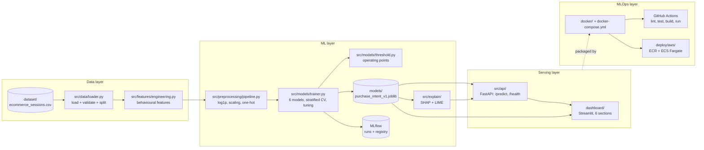
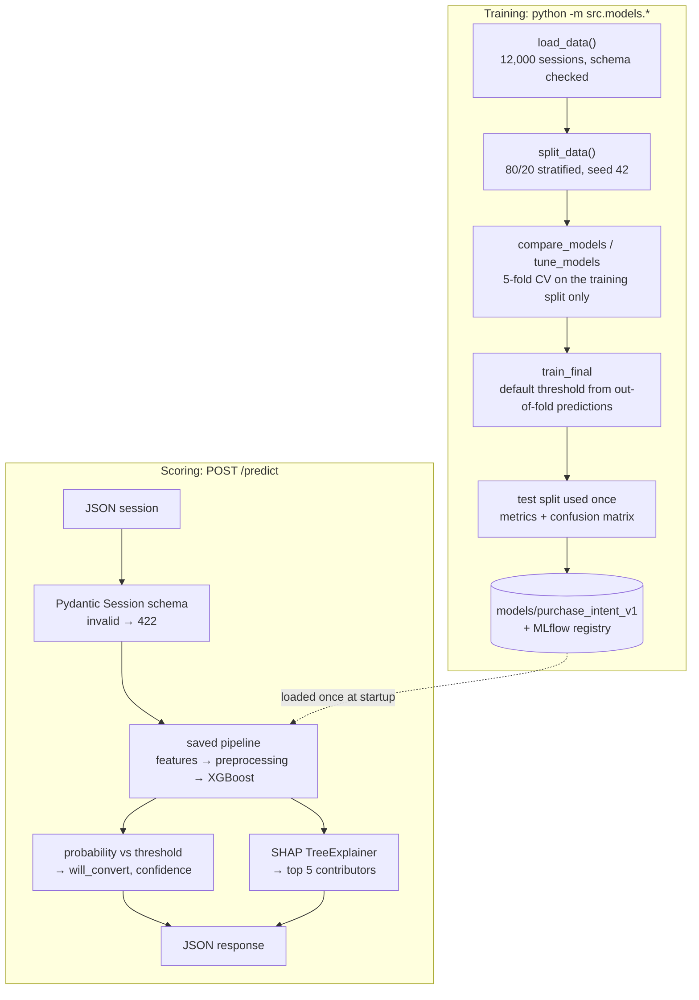

# Architecture

The system has four layers. Configuration (`src/config/config.yaml`) and logging
(`src/utils/logger.py`) are shared by all of them.

## Architecture diagram

| Layer | What it does | Main files |
|---|---|---|
| Data | Reads the CSV, checks the schema, makes a stratified train/test split, adds engineered features | `src/data/`, `src/features/engineering.py` |
| ML | Preprocesses, compares and tunes six models, sets the default threshold, explains, logs to MLflow, saves the model | `src/preprocessing/`, `src/models/`, `src/explain/` |
| Serving | Scores sessions over HTTP and shows analytics, comparison, explanations and the threshold trade-off | `src/api/`, `dashboard/` |
| MLOps | Packages the API and dashboard, checks every push, prepares AWS deployment | `docker/`, `.github/workflows/`, `deploy/aws/` |

## Workflow diagram

Two flows: training (run by a developer) and scoring (run for every session).

## Following one session from CSV row to response

1. **Row in the CSV:** `ProductRelated = 19, ExitRates = 0.042, Month = June, PageValues = 68.6, …`
2. **Loader:** checks every column exists, is the right type and isn't missing.
3. **Feature step:** adds `total_pages = 20`, `total_duration = 298.5` and the other ratios.
4. **Preprocessing:** log1p and scaling for counts and durations, one-hot encoding for Month and
   the ID columns. PageValues, Administrative, Informational, VisitorType and Weekend are left out
   (see the model card).
5. **Model:** XGBoost gives a score in log-odds, which becomes a probability: 0.135.
6. **Decision:** 0.135 is below the default threshold of 0.27, so `will_convert` is false, with
   `medium` confidence (0.135 is 0.135 away from the threshold).
7. **Explanation:** SHAP splits the score into contributions: the low exit rate pushes it up
   (+0.25), only 19 product pages pull it down (−0.21), and so on.
8. **Response:** all of this is returned as JSON (see `docs/api.md`).

Steps 3–5 run inside one saved scikit-learn pipeline, so training and serving can't drift apart.

## Design choices

| Choice | Why |
|---|---|
| One pipeline for features, preprocessing and model | Fitted only on training folds (no leakage), and the API reuses exactly the same object (no train/serve skew) |
| PageValues left out | Not known mid-session; using it would be data leakage |
| Threshold chosen by the CRO team | The value of a conversion and the cost of a nudge are business decisions; the tooling shows the trade-off |
| SHAP in the API, LIME as a check | SHAP is exact and fast for tree models; LIME is an independent but approximate view |
| Model loaded once at startup | Each request takes about 9 ms instead of reloading the model every time |
| API and dashboard in separate containers | They can be scaled and updated separately; the dashboard calls the API |
