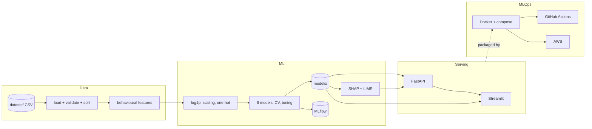
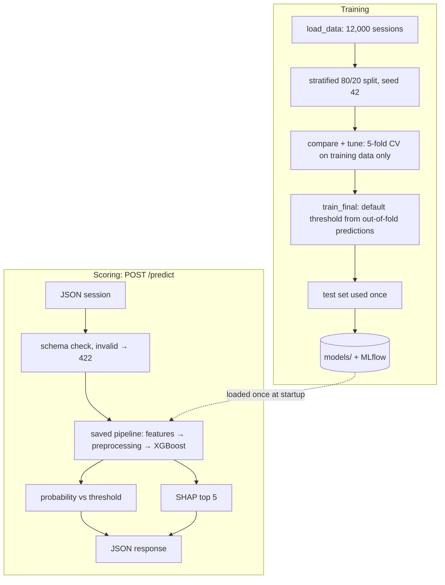

# User guide

1. [Setup](#1-setup)
2. [Running the pipeline](#2-running-the-pipeline)
3. [Using the dashboard](#3-using-the-dashboard)
4. [Using the API](#4-using-the-api)
5. [How it works](#5-how-it-works)
6. [Model card](#6-model-card)
7. [Deploying to AWS](#7-deploying-to-aws)

---

## 1. Setup

### With Docker (quickest)

```bash
git clone https://github.com/priyankavasavada/purchase_intent_xai.git
cd purchase_intent_xai
docker compose up --build
```

Dashboard: http://localhost:8501 · API docs: http://localhost:8000/docs

The trained model is in the repo, so nothing needs training first. To change the ports,
copy `.env.example` to `.env` and edit `API_PORT` / `DASHBOARD_PORT`.

### With Python

Needs Python 3.12.

```bash
python3.12 -m venv .venv
source .venv/bin/activate            # Windows: .venv\Scripts\activate
pip install -r requirements.txt
pytest                               # about 20 seconds, all should pass
```

**macOS only:** XGBoost and LightGBM need OpenMP. Run `brew install libomp`. If you can't use
Homebrew, add this line to the end of `.venv/bin/activate` and activate again:

```bash
export DYLD_FALLBACK_LIBRARY_PATH="$VIRTUAL_ENV/lib/python3.12/site-packages/sklearn/.dylibs"
```

Start the services:

```bash
uvicorn src.api.main:app --reload          # API: http://127.0.0.1:8000/docs
streamlit run dashboard/app.py             # dashboard: http://localhost:8501
```

The dashboard scores sessions itself by default. To make it go through the running API
instead (as it does in Docker), start it with
`API_URL=http://127.0.0.1:8000 streamlit run dashboard/app.py`.

### Troubleshooting

| Problem | Fix |
|---|---|
| `libxgboost.dylib could not be loaded` | macOS OpenMP, see above |
| `No 'purchase_intent' model in .../models` | Run `python -m src.models.train_final` |
| `No module named 'src'` | Run commands from the project root with the environment activated |
| Port already in use | Change the port in `.env`, or stop the other program |

---

## 2. Running the pipeline

The saved model is already in `models/`. To rebuild everything, in order:

```bash
python -m src.features.selection      # feature rankings              (~1 min)
python -m src.models.compare_models   # six models, ± PageValues      (~1 min)
python -m src.models.tune_models      # tuning                        (~10 min)
python -m src.models.train_final      # final models + MLflow         (~1 min)
python -m src.explain.report          # SHAP importance for the dashboard
python -m src.models.tracking         # MLflow run log -> reports/mlflow_runs.csv
```

Each training run saves a new version (`purchase_intent_v2`, ...); the API and dashboard
always load the newest. The same data and seed give the same results.

To browse experiments: `mlflow ui --backend-store-uri sqlite:///mlflow.db`, then open
http://127.0.0.1:5000.

The notebooks (`notebooks/01_eda` to `04_xai`) only read data and saved results.

---

## 3. Using the dashboard

For the growth / CRO team. Pick a section in the sidebar.

| Term | Meaning |
|---|---|
| Threshold | Sessions with a probability at or above it get a nudge |
| Recall / buyers reached | Of the people who would buy, the share who get a nudge |
| Precision / nudged who buy | Of the people nudged, the share who buy |
| PR-AUC | How well the model ranks buyers above non-buyers, 0 to 1 (guessing: 0.157) |

**Overview:** headline numbers. The model does not use PageValues (see section 6).

**Live session scoring:** enter what a visitor has done so far and press *Score session*. You get
the chance of buying, the decision (*Nudge* / *Don't nudge*), a confidence label (*low* means the
chance is close to the threshold) and the reasons: orange bars push towards buying, blue bars
away. The expander at the bottom shows what a model *with* PageValues would say, for comparison only.

**Funnel & cohorts:** analytics on all 12,000 sessions, filtered by month and visitor type.
Conversion by engagement, and by month, traffic source, region, browser or operating system.
Hover a bar for its session count; small groups are noisy.

**Model comparison:** the six algorithms tried (the top five are within about 0.015 PR-AUC), and
the models with and without PageValues. The gap between them is the price of scoring mid-visit.

**Explainability:** what drives the model overall, and why any test session got its score,
explained by SHAP (exact, used in the API) and LIME (an independent, approximate check).

**Performance & threshold:** where you pick your operating point.

1. Move the threshold slider: lower reaches more buyers but nudges more people who won't buy.
2. Enter the value of a reached buyer and the cost of a nudge. The page finds the threshold
   with the best net value on the test sessions, or tells you no threshold pays.
   Use the *extra* value a nudge brings, not the full order value: many nudged buyers would
   have bought anyway. A group is only worth nudging if its precision is above cost ÷ value.
3. Use that threshold in the API with `?threshold=...`.

---

## 4. Using the API

| Endpoint | Does |
|---|---|
| `POST /predict` | Scores one session. Optional `?threshold=0.4` overrides the default (0.27). |
| `GET /health` | Says the server is up and which model is loaded |
| `GET /docs` | Interactive documentation |

**Request:** 16 fields, all required. Page counts are integers ≥ 0, durations are seconds ≥ 0,
`BounceRates`, `ExitRates` and `SpecialDay` are between 0 and 1, `Month` and `VisitorType` are
text, the four ID fields are integers, `Weekend` is true/false. Unknown categories (e.g. `"Month": "Jan"`)
are accepted. Don't send `PageValues`; extra fields are ignored.

```bash
curl -X POST "localhost:8000/predict" -H "Content-Type: application/json" -d @examples/api_request.json
```

**Response:**

```json
{
  "model_version": "purchase_intent_v1",
  "conversion_probability": 0.1347,
  "will_convert": false,
  "threshold": 0.27,
  "confidence": "medium",
  "top_contributors": [
    {"feature": "ExitRates", "value": 0.042106, "contribution": 0.2532, "effect": "increases"},
    {"feature": "ProductRelated", "value": 19, "contribution": -0.2051, "effect": "decreases"}
  ]
}
```

A 13% chance of buying, below the threshold, so no nudge. `confidence` is *low* within 0.1 of
the threshold, *medium* within 0.25, *high* beyond (a rule of thumb, not a certainty).
`top_contributors` lists the 5 behaviours that moved the score most; `contribution` is a SHAP
value in log-odds, useful for comparing features, not a probability. Features like
`total_pages` are calculated from the fields you send.

**Errors:** invalid input (missing field, wrong type, out of range, bad threshold) gets HTTP 422
naming the field. Every request is logged as
`request method=POST path=/predict status=200 duration_ms=9.4`.

**Code:** `src/api/main.py` (endpoints, loads the model once at startup), `schemas.py`
(what a request and response look like), `scoring.py` (probability, decision, reasons).

---

## 5. How it works

### Architecture



Configuration (`src/config/config.yaml`) and logging are shared by every layer.

### Workflow



### One session, from CSV row to response

1. The loader checks the row's columns and types.
2. The feature step adds `total_pages`, `total_duration` and four ratios.
3. Preprocessing applies log1p and scaling to counts and durations, and one-hot encoding to
   Month and the ID columns. PageValues and four weak columns are left out.
4. XGBoost gives a probability (0.135 for the example above).
5. It is compared with the threshold (0.27): no nudge, medium confidence.
6. SHAP splits the score into contributions per behaviour, returned as JSON.

Steps 2–4 are one saved scikit-learn pipeline, so training and serving can't drift apart.

---

## 6. Model card

**Model:** `purchase_intent_v1`, tuned XGBoost in a scikit-learn pipeline. MLflow registry:
`purchase-intent` version 1. Trained 2026-11-13.

**Intended use:** score a shopping session mid-visit, so a CRO team can decide whether to show
an offer. **Not for:** pricing, credit or other decisions about individuals; joining to
personal data; measuring whether nudges work (that needs an A/B test); scoring right at the
start of a visit.

**Data:** 12,000 anonymised sessions, 15.7% converted. 9,600 for training, 2,400 for testing.

**Features left out:**

| Feature | Why |
|---|---|
| PageValues | Data leakage: it fills in on the way to checkout, so it isn't known mid-session. No buyer has PageValues = 0. |
| Administrative, Informational, VisitorType, Weekend | Weak in feature selection; removing them did not lower PR-AUC |

**Performance on the test set** (default threshold 0.27):

| PR-AUC | Recall | Precision | ROC-AUC | Accuracy |
|---|---|---|---|---|
| 0.559 (guessing: 0.157) | 0.610 | 0.529 | 0.849 | 0.853 (always "no": 0.843) |

| | Predicted no | Predicted buy |
|---|---|---|
| Actual no | 1,818 | 205 |
| Actual buy | 147 | 230 |

Cross-validated PR-AUC was 0.538 ± 0.019. The comparison model with PageValues reaches 0.867,
which is not reachable when scoring mid-session.

**Threshold:** 0.27 is a neutral default (best F1 on out-of-fold training predictions). The
team picks the real one from its own value and cost (section 3).

**What drives it:** a high exit rate lowers the score; more product pages raise it, with a step
at about 25–30 pages. SHAP and LIME agree on direction for 40 out of 40 test sessions checked.

**Limitations:** trained on whole-session totals, so early in a visit performance is likely
lower; probabilities are not formally calibrated; ten months of data with no year, so check
again on new data; explanations describe the model, not cause and effect.

**Responsible use:** keep predictions away from identifying data, use them only for low-stakes
site offers, and tell users about personalised offers where the law requires it.

---

## 7. Deploying to AWS

Nothing has been deployed by default: the brief requires no cloud spend.

### Free: one EC2 server

AWS changed its free tier on 15 July 2025. Newer accounts get a free plan with $100–200 of
credits for 6 months (no charges unless you upgrade); use a `t3.small`. Older accounts in their
first year get 750 hours a month of `t3.micro`; add swap. A `t3.small` uses roughly $20 of credit
a month. Check **Billing → Free Tier** for your account, and create a zero-spend budget alert first.

1. **EC2 → Launch instance:** Ubuntu 24.04, `t3.small`, a new key pair, 20 GiB disk. Security
   group: SSH (22) from your IP, TCP 8501 and 8000 from anywhere.
2. Connect and install Docker:

   ```bash
   ssh -i purchase-intent.pem ubuntu@<public-ip>
   sudo fallocate -l 2G /swapfile && sudo chmod 600 /swapfile && sudo mkswap /swapfile && sudo swapon /swapfile
   curl -fsSL https://get.docker.com | sudo sh
   sudo usermod -aG docker ubuntu && exit
   ```

3. Connect again, then start it:

   ```bash
   git clone https://github.com/priyankavasavada/purchase_intent_xai.git
   cd purchase_intent_xai
   docker compose up --detach --build
   ```

   For a private repo, use a read-only GitHub access token as the password.
4. Open `http://<public-ip>:8501` and `http://<public-ip>:8000/docs`.

Update with `git pull && docker compose up --detach --build`. Stop the instance when not in use;
terminate it when finished. The API has no login, so don't put private data behind it.

### Production style: ECR + ECS Fargate

Costs money from the first hour. Needs the AWS CLI, Docker and `envsubst`.

```bash
cp .env.example .env                       # fill in AWS_REGION and AWS_ACCOUNT_ID
bash deploy/aws/push_images.sh             # builds for x86_64, pushes to ECR
aws ecs register-task-definition --cli-input-json file://deploy/aws/task-definition.rendered.json
aws ecs create-cluster --cluster-name purchase-intent
aws ecs create-service --cluster purchase-intent --service-name purchase-intent \
  --task-definition purchase-intent --desired-count 1 --launch-type FARGATE \
  --network-configuration "awsvpcConfiguration={subnets=[<subnet>],securityGroups=[<sg>],assignPublicIp=ENABLED}"
```

Both containers run in one task, so the dashboard reaches the API at `localhost:8000`. Logs go to
CloudWatch (`/ecs/purchase-intent`). To roll back, update the service to an earlier task
definition revision. To clean up, scale the service to 0, then delete the service, the cluster
and the two ECR repositories.
